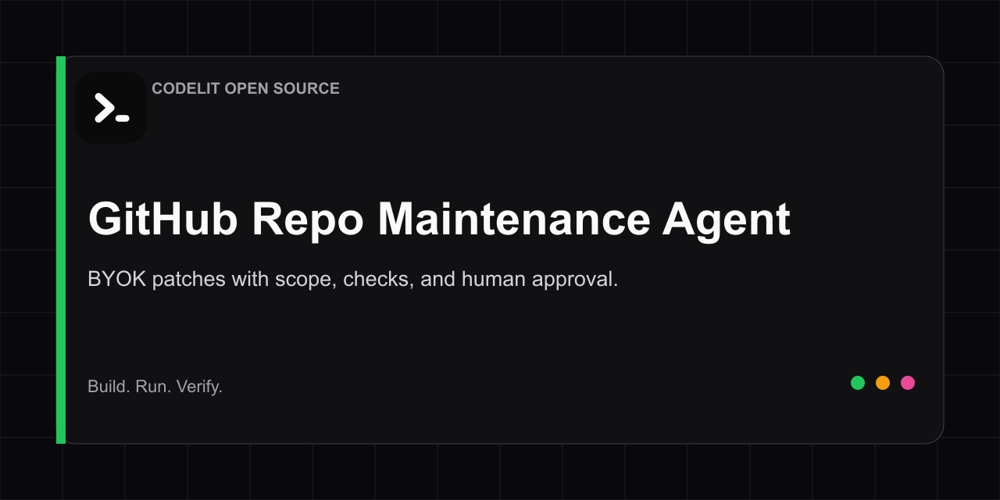

# GitHub Repo Maintenance Agent



A local, bring-your-own-key maintenance agent that turns a bounded issue into
a reviewable patch. The model can propose; deterministic policy decides whether
the patch is in scope; a human explicitly approves application; fixed checks
must pass before the tool can commit or open a draft pull request.

[Open the visual Team Flow in Codelit](https://codelit.io/agents/claude-code-repo-maintenance-agent?sample=1&source=github&utm_source=github&utm_medium=repository&utm_campaign=github_open_source&utm_content=github-repo-maintenance-agent) |
[Local Runs documentation](https://codelit.io/docs/local-runs?utm_source=github&utm_medium=repository&utm_campaign=github_open_source&utm_content=github-repo-maintenance-agent) |
[Browse Agent Teams](https://codelit.io/agents?utm_source=github&utm_medium=repository&utm_campaign=github_open_source&utm_content=github-repo-maintenance-agent)

## Preview without a key

```bash
npm install
npm run preview
npm run verify
```

## Configure a repository

Edit `maintenance.config.json`:

- `contextPaths` are the only files sent to your selected model.
- `allowedPaths` are the only files a proposed patch may change.
- `blockedPaths` extend built-in blocks for secrets, workflows, migrations, and infrastructure.
- `verifyCommands` are fixed by the repository owner, not the model.
- Patch bytes, files, lines, and context all have explicit caps.

The included fixture and `issues/example.md` make the safety flow inspectable
before you point it at a real repository.

## Propose, review, then apply

```bash
export CODELIT_PROVIDER=openai
export CODELIT_MODEL=gpt-4o-mini
export OPENAI_API_KEY=...

npm run maintain -- plan --issue issues/example.md
# Review .codelit/proposal.patch
npm run maintain -- apply
```

The apply command requires a clean worktree, creates a new `codelit/*` branch,
revalidates the patch, applies it with Git, runs every configured check, and
commits only on success. It does not push.

To apply the reviewed proposal and open a draft PR in the same approved step,
use this command instead of the plain apply command:

```bash
gh auth login
npm run maintain -- apply --draft-pr
```

The runner can never merge, approve, or deploy. See
[the implementation boundary](docs/implementation-boundary.md) for the exact
free and hosted split.

## License

MIT
